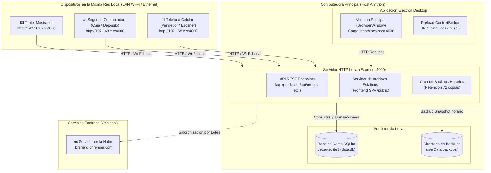

# RD POS System - Sistema de Punto de Venta y Gestión Comercial

Sistema de escritorio y red local desarrollado para la administración de inventario, facturación en mostrador y gestión comercial de comercios minoristas y mayoristas (librería y papelería comercial).

---

## 🚀 ¿Cómo Funciona el Sistema?

El sistema combina la potencia y portabilidad de una aplicación de escritorio con la flexibilidad de una arquitectura cliente-servidor distribuida en red de área local (LAN).



### Principio de Operación
1. **Inicio del Núcleo:** Al ejecutar la aplicación, Electron inicializa la base de datos local SQLite y arranca un servidor web Express embebido escuchando en el puerto `4000`.
2. **Interfaz de Escritorio:** Electron abre su ventana principal apuntando a `http://localhost:4000`, ofreciendo al usuario una experiencia de aplicación nativa.
3. **Acceso Multi-Dispositivo Simultáneo:** Cualquier dispositivo conectado a la misma red local (Wi-Fi o cable de red) puede abrir el navegador web e ingresar a `http://<IP_LOCAL>:4000` para operar el sistema en tiempo real. La IP local del servidor se calcula y muestra automáticamente en la pantalla de inicio del sistema.
4. **Almacenamiento Local Offline:** No depende de conectividad a internet para facturar o consultar precios. Todos los datos residen en `data.db` en el equipo local.
5. **Backups Automatizados:** Cada hora se toma una instantánea completa de la base de datos con rotación automática de hasta 72 copias (3 días continuos de historial).

---

## 📦 Módulos Principales del Sistema

### 1. Punto de Venta (POS) y Órdenes de Venta
* Creación de órdenes en mostrador con selección ágil de cliente y tipo de venta (Mayorista o Minorista).
* **Experiencia Móvil Nativa (Responsive POS):** Interfaz adaptativa optimizada para teléfonos celulares y tablets en red LAN con tarjetas táctiles de carrito, botones de cantidad ergonómicos y prevención de zoom automático.
* Escaneo de códigos de barra mediante pistola lectora o cámara web con decodificación en vivo.
* **Cálculo de Descuentos por Volumen:** En ventas minoristas, evalúa dinámicamente las cantidades de cada producto y aplica los precios de escala definidos.
* Registro de métodos de pago (Efectivo, Transferencia, Tarjeta, Cuenta Corriente) y pagos a cuenta / adelantos (`advancement`).
* Emisión e impresión directa de comprobantes de venta (no válidos como factura) con detalle de importes, descuentos y datos bancarios para transferencia.
* Descarga de recibos en formato PDF.

### 2. Catálogo de Productos e Inventario
* Gestión completa de artículos con nombre, descripción, stock y proveedor asignado.
* Esquema financiero en centavos para eliminar discrepancias de redondeo monetario.
* Precios diferenciados (Mayorista y Minorista) y configuración de hasta 4 tramos de descuento por volumen.
* **Historial de Precios y Auditoría:** Registro cronológico exhaustivo de cada cambio de precio (`price_history`) con valor anterior, nuevo, diferencia monetaria y porcentaje de variación.
* **Ordenamiento por Actualización de Precios:** Capacidad de ordenar productos por su última fecha de modificación de precios (`price_updated_at`), facilitando la revisión de artículos desactualizados.
* Generador de códigos de barras internos normalizados (`RD<YY><000000000>`).
* Búsqueda por palabras múltiples (*multi-token search*) insensible a mayúsculas/minúsculas.
* Baja lógica (*soft delete*) para proteger la integridad histórica de ventas.

### 3. Clientes y Proveedores
* Agenda comercial de clientes con CUIL/CUIT, correo electrónico, teléfono, dirección y tipo de lista preferente (`minor`/`major`).
* Directorio de proveedores comerciales con asignación de códigos y protección referencial en bajas.

### 4. Gestión de Listas de Precios e Integración con Excel
* **Exportación de Lista Interna:** Generación de archivo Excel estructurado con precios de costo, márgenes y las 4 escalas de descuento.
* **Exportación de Lista para Clientes:** Catálogo en formato `.xlsx` limpio y ordenado para envío comercial a clientes.
* **Importación Masiva:** Actualización masiva de precios y descuentos mediante subida de planilla Excel procesada en una única transacción atómica.

### 5. Respaldo y Mantenimiento de Base de Datos
* Tarea cron horaria de copias de seguridad de SQLite.
* Herramienta de desfragmentación y optimización de base de datos (`VACUUM`) desde el panel de opciones.
* Descarga directa del archivo de base de datos `.db` para resguardo manual externo.

### 6. Analítica y Reportes
* Dashboard con visualización gráfica de evolución de ventas diarias mediante Chart.js.
* Filtros por rangos de fechas.

---

## 🛠️ Tecnologías y Modernización en Curso

El proyecto se encuentra en un proceso planificado de refactorización integral y modernización técnica:

| Aspecto | Estado | Tecnología Implementada |
| :--- | :--- | :--- |
| **Gestor de Paquetes** | Migrado | **PNPM** (`pnpm-lock.yaml`) |
| **Lenguaje** | Migrado 100% | **TypeScript** (Strict Mode de punta a punta) |
| **Arquitectura Frontend** | Migrado | **React 19** + **TypeScript** + **Vite** + **QR LAN** |
| **Arquitectura Backend** | Migrado | **Capas y Clases** (PEAA + GoF + SOLID) |
| **Límite de Clases/Archivos**| Cumplido | **~100 líneas máximo** por clase/archivo (SRP) |
| **Testing** | 100% Pasando | **Vitest** (41 tests: Dominio, Casos de Uso, Repositorios, Migraciones, POS, Historial de Precios, Filtros, Express) |
| **Retrocompatibilidad** | Garantizada | **SchemaMigrationRunner** con migraciones atómicas y defensivas |

Para detalles exhaustivos sobre los patrones de diseño (Repository, Service Layer, Domain Model, Value Objects, Factory, Adapter, Strategy), requerimientos y decisiones técnicas, consultar el archivo [`REQUERIMIENTOS.md`](./REQUERIMIENTOS.md).

---

## 💻 Requisitos Previos e Instalación

### Requisitos
* **Node.js:** Versión 18.0 o superior (recomendado v20+ o v24+).
* **PNPM:** Gestor de paquetes recomendado (`npm install -g pnpm`).

### Instalación con PNPM

```bash
# 1. Clonar el repositorio
git clone https://github.com/degetmateo/pos-system-desktop.git
cd pos-system-desktop

# 2. Instalar dependencias con PNPM (genera node_modules con node-linker=hoisted según .npmrc)
pnpm install

# 3. Iniciar la aplicación en modo desarrollo
pnpm start
```

### Scripts Disponibles en `package.json`
* `pnpm start`: Compila el servidor TypeScript y el frontend Vite, asegura el módulo nativo `better-sqlite3` en ABI 140 de Electron (`electron-rebuild`) e inicia la aplicación mediante Electron Forge.
* `pnpm test`: Ejecuta la suite de pruebas unitarias e integradas con Vitest directamente sobre el entorno de Electron Node (`cross-env ELECTRON_RUN_AS_NODE=1`), compartiendo el mismo ABI 140 sin conflictos de compilación.
* `pnpm run build`: Compila TypeScript para el backend (`tsconfig.server.json`) y empaqueta el frontend con Vite.
* `pnpm run package`: Empaqueta la aplicación completa en binarios ejecutables locales para Windows en `out/rd-win32-x64/rd.exe`.
* `pnpm run start:prod`: Empaqueta la aplicación y lanza de inmediato el binario empaquetado `out\rd-win32-x64\rd.exe` para probar la aplicación exactamente como se comportará en producción.
* `pnpm run make`: Genera los instaladores oficiales y distribuibles de producción (instalador Squirrel Windows: `rd-0.0.22 Setup.exe`, `.nupkg` y `RELEASES` en `out/make/squirrel.windows/x64/`).
* `pnpm run publish` (o `pnpm release`): Compila, recompila módulos nativos y publica la release en GitHub Releases con los instaladores (`@electron-forge/publisher-github`). *Nota*: usar siempre `pnpm run publish` o `pnpm release` en lugar de `pnpm publish` a secas (ya que este último es un comando reservado de PNPM que intenta subir librerías a npmjs.org).

---

## 📐 Estructura del Directorio del Proyecto

```
rd/
├── assets/                     # Recursos visuales (íconos .ico, logos .png)
├── dist/                       # Artefactos compilados de TypeScript y Vite (dist/public)
├── src/
│   ├── domain/                 # Capa de Dominio (Entidades, Value Objects, Estrategias de Precios)
│   │   ├── errors/             # Errores de dominio (NotFound, Conflict, InvalidArgument)
│   │   ├── models/             # Product, Order, OrderItem, Customer, Provider, MinorPrice
│   │   ├── strategies/         # PricingStrategy (Major, Minor por escala)
│   │   └── value-objects/      # Money (en centavos), Barcode, PaymentMethod, OrderType
│   ├── application/            # Capa de Aplicación (Casos de Uso, Servicios, Puertos, DTOs)
│   │   ├── dtos/               # DTOs de entrada/salida tipados
│   │   ├── ports/              # Interfaces de repositorios y generadores de archivos
│   │   └── services/           # ProductService, OrderService, CustomerService, BarcodeService...
│   ├── infrastructure/         # Capa de Infraestructura (Persistencia, Adaptadores, Mantenimiento)
│   │   ├── adapters/           # ExceljsAdapter, PdfMakeAdapter
│   │   ├── database/           # SqliteConnection (WAL mode), SchemaMigrationRunner
│   │   ├── maintenance/        # BackupFacade (snapshots rotativos horarios)
│   │   └── repositories/       # SqliteProductRepository, SqliteOrderRepository...
│   ├── presentation/           # Capa de Presentación (Servidor Express y Controladores REST)
│   │   ├── controllers/        # ProductController, OrderController, CustomerController...
│   │   └── server/             # ExpressApp (API REST, middlewares, SPA fallback)
│   ├── desktop/                # Proceso Principal de Electron
│   │   ├── electron.main.ts    # Inicialización de Electron, base de datos y Express
│   │   ├── window.factory.ts   # Factory para creación de BrowserWindow y auto-reintento
│   │   └── preload.ts          # ContextBridge seguro
│   └── public/                 # Frontend Web SPA (React 19 + TypeScript + Vite)
│       ├── components/         # Sidebar, Header, ToastContainer
│       ├── services/           # ApiClient (HTTP tipado), ToastService
│       ├── types/              # DTOs de API y tipos de dominio UI
│       ├── views/              # Vistas: HomeView (QR LAN), PosView, ProductsView, CustomersView...
│       │   ├── pos/            # PosCartTable, PosSummaryPanel, PosTopBar, PosCartCalculator...
│       │   ├── products/       # ProductsTable, ProductModal, ProductDiscountsSubForm...
│       │   ├── customers/      # CustomersTable, CustomerModal
│       │   └── orders/         # OrdersTable, OrderDetailModal
│       ├── styles/             # app.css (Diseño responsivo, paleta celeste institucional)
│       ├── App.tsx             # Componente raíz con enrutamiento de vistas y layout responsivo
│       ├── main.tsx            # Punto de montaje React 19
│       └── index.html          # HTML principal con viewport mobile y logo favicon
├── tests/                      # Suite de pruebas unitarias e integradas con Vitest
├── forge.config.js             # Configuración de empaquetado y publicación de Electron Forge
├── package.json                # Configuración de dependencias, scripts de build y tests
├── tsconfig.json               # Configuración de TypeScript
├── vite.config.mts             # Configuración de bundling del frontend con Vite
├── vitest.config.mts           # Configuración de runner de pruebas con Vitest
├── README.md                   # Descripción general y guía de uso
└── REQUERIMIENTOS.md           # Requerimientos, patrones PEAA/GoF y decisiones de diseño
```

---

## 🏛️ Lineamientos de Arquitectura y Contribución

1. **Principio de Responsabilidad Única (SRP):** Cada clase y archivo debe resolver una sola responsabilidad.
2. **Límite de ~100 líneas por archivo:** Si una clase o archivo sobrepasa las 100 líneas, debe refactorizarse extrayendo responsabilidades auxiliares en colaboradores, estrategias o adaptadores.
3. **Encapsulamiento en Clases:** Se prioriza la programación orientada a objetos con clases cohesivas y tipadas.
4. **Patrones PEAA y GoF:** Toda persistencia debe pasar por `Repositories`; la lógica de negocio debe residir en el `Domain Model` o en `Services`; las integraciones de terceros deben estar aisladas mediante `Adapters` y `Facades`.
5. **Aritmética Monetaria Segura:** Los precios siempre se manejan en centavos enteros para evitar errores de precisión en coma flotante.
6. **Tests Obligatorios:** Toda nueva funcionalidad o refactorización debe estar respaldada por sus pruebas unitarias correspondientes.

