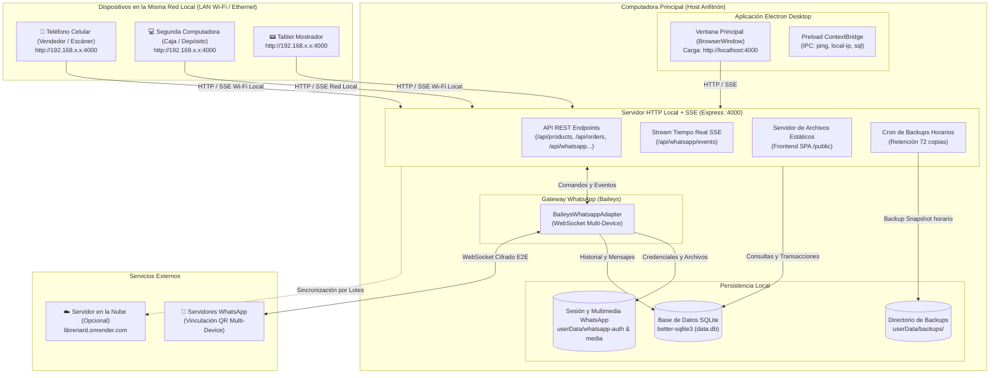

# RD POS System - Sistema de Punto de Venta y Gestión Comercial

Sistema de escritorio y red local desarrollado para la administración de catálogo, facturación ágil en mostrador, comunicación comercial por WhatsApp integrada y gestión integral de comercios minoristas y mayoristas (librería y papelería comercial).

---

## 🚀 ¿Cómo Funciona el Sistema?

El sistema combina la potencia y portabilidad de una aplicación de escritorio con la flexibilidad de una arquitectura cliente-servidor distribuida en red de área local (LAN) e integración directa con WhatsApp Multi-Dispositivo.



### Principio de Operación
1. **Inicio del Núcleo:** Al ejecutar la aplicación, Electron inicializa la base de datos local SQLite (`SchemaMigrationRunner`), ensambla los servicios mediante `AppContainer`, arranca el servidor Express embebido en el puerto `4000` y reconecta automáticamente la sesión de WhatsApp si ya fue vinculada previamente.
2. **Interfaz de Escritorio:** Electron abre su ventana principal apuntando a `http://localhost:4000`, ofreciendo al usuario una experiencia de aplicación nativa.
3. **Acceso Multi-Dispositivo Simultáneo:** Cualquier dispositivo conectado a la misma red local (Wi-Fi o cable de red) puede abrir el navegador web e ingresar a `http://<IP_LOCAL>:4000` para operar el sistema y el módulo de WhatsApp en tiempo real. La IP local del servidor se calcula y muestra automáticamente en la pantalla de inicio del sistema.
4. **Almacenamiento Local Offline:** No depende de conectividad a internet para facturar o consultar precios. Todos los datos residen en `data.db` en el equipo local.
5. **Backups Automatizados:** Cada hora se toma una instantánea completa de la base de datos con rotación automática de hasta 72 copias (3 días continuos de historial).

---

## 📦 Módulos Principales del Sistema

### 1. Punto de Venta (POS) y Órdenes de Venta
* Creación de órdenes en mostrador con selección ágil de cliente y tipo de venta (Mayorista o Minorista).
* **Modalidad V2 en Planilla Rápida (Hoja de Cálculo / Excel):** Carga continua de artículos en tabla dinámica con autocompletado flotante de productos sobre el nombre, navegación con teclado (flechas, `Tab` y `Enter` para saltar de fila o generar nuevas filas automáticamente) y alta/actualización directa en base de datos.
* **Experiencia Móvil Nativa (Responsive POS):** Interfaz adaptativa optimizada para teléfonos celulares y tablets en red LAN con tarjetas táctiles de carrito, botones de cantidad ergonómicos y prevención de zoom automático.
* Escaneo de códigos de barra mediante pistola lectora o cámara web con decodificación en vivo.
* **Atajo para Rehacer Órdenes:** Botón directo tanto en el historial de órdenes como en el modal de detalle de comprobante que carga todos los datos de una orden existente en una nueva orden para rehacerla y modificarla libremente en la vista V2 antes de confirmar.
* **Cálculo de Descuentos por Volumen:** En ventas minoristas, evalúa dinámicamente las cantidades de cada producto y aplica los precios de escala definidos.
* Registro de métodos de pago (Efectivo, Transferencia, Tarjeta, Cuenta Corriente) y pagos a cuenta / adelantos (`advancement`).
* Emisión e impresión directa de comprobantes de venta (no válidos como factura) con detalle de importes, descuentos y datos bancarios para transferencia.
* **Captura de Comprobante / Presupuesto en Imagen:** Generación automática de imagen idéntica al formato de cotización en Excel con logo, cabecera de contacto, número correlativo de comprobante (`ORDEN N° <N>`), datos de pago (`ALIAS : ogro.caso.ruina`) y total a cobrar copiada al portapapeles para pegar directamente en WhatsApp (`Ctrl + V`).
* **Copia Rápida de PDF al Portapapeles:** Inyección del archivo PDF en el portapapeles de Windows para adjuntarlo sin descargas ni búsquedas en carpetas.
* Descarga de recibos en formato PDF e impresión térmica/A4 directa.

### 2. WhatsApp del Negocio Integrado (Baileys + CRM)
* **Vinculación Directa mediante Código QR:** Vista integrada (`WhatsApp Web`) que genera y actualiza en vivo el código QR de vinculación con el celular del negocio utilizando `@whiskeysockets/baileys` (arquitectura Multi-Device nativa, sin depender de navegadores externos).
* **Unificación Automática de Identidades (`@lid` ↔ `@s.whatsapp.net`):** Resuelve y fusiona transaccionalmente los identificadores internos de privacidad de WhatsApp (`@lid`) con el número telefónico real (`@s.whatsapp.net`) usando `whatsapp_lid_mappings`, el repositorio criptográfico de Baileys (`signalRepository.lidMapping`) y la agenda sincronizada, manteniendo un único chat por contacto y mostrando siempre su nombre agendado en lugar de dígitos internos ininteligibles.
* **Sincronización Automática con Cartera de Clientes:** Al recibir o sincronizar mensajes en WhatsApp, busca al cliente en `data.db` por número telefónico normalizado:
  * **Si el cliente ya existe:** conserva su razón social formal y guarda/actualiza su nombre agendado en WhatsApp (`whatsapp_name`), vinculando el chat con `customer_id`.
  * **Si no existe:** crea automáticamente el registro del cliente con su nombre agendado en WhatsApp, su número telefónico y el **tipo de cliente sin asignar por defecto (`null`)**.
* **Detección de Clientes Prioritarios e Insignias de Importancia:** Cruza en tiempo real los chats con el historial de órdenes para destacar clientes prioritarios (`★ Prioritario` por volumen de compras/órdenes) directamente en la card del chat y en la cabecera. Permite clasificar contactos con niveles de importancia (`Importante`, `Normal`, `Poca importancia`, `Ignorar`) con badges visuales y ordenar o filtrar el panel lateral por **Recientes**, **Importancia** o **Mayores Compradores**.
* **Sincronización y Recepción 100% en Segundo Plano (No Bloqueante):** Procesamiento cooperativo por lotes (`BackgroundTaskQueue` con `setImmediate`, colas de prioridad `high`/`low` y descarga diferida de multimedia) en backend y almacén reactivo global en segundo plano (`WhatsappBackgroundStore` con `useSyncExternalStore`, `startTransition`, *Proxy Cache* de mensajes y coalescencia de eventos SSE) en frontend, permitiendo facturar o navegar el catálogo sin bloqueos mientras llegan mensajes o se sincroniza el historial, con apertura instantánea de la vista y posicionamiento automático del scroll al último mensaje.
* **Tiempo Real vía Server-Sent Events (SSE):** Recepción instantánea de mensajes entrantes, contador global de no leídos en el menú lateral, fusión de chats duplicados (`chat_deleted`), sincronización de historial/contactos y confirmaciones (`✓`, `✓✓`) mediante `/api/whatsapp/events`.
* **Envío de Texto, Imágenes, Audio y Documentos (con Pegado `Ctrl + V`):** Permite adjuntar archivos PDF/imágenes o pegar directamente con `Ctrl + V` las capturas de presupuestos generadas en el POS dentro del cuadro de escritura de WhatsApp.
* **Persistencia y Analítica Local de Conversaciones:** Historial de chats, mapeos de identidad y métricas diarias/por contacto almacenados localmente en SQLite (`whatsapp_chats`, `whatsapp_messages`, `whatsapp_lid_mappings`) con reconexión automática al abrir la app.

### 3. Catálogo de Productos
* Gestión completa de artículos con nombre, descripción, código de barras y proveedor asignado.
* Esquema financiero en centavos para eliminar discrepancias de redondeo monetario.
* Precios diferenciados (Mayorista y Minorista) y configuración de hasta 4 tramos de descuento por volumen.
* **Historial de Precios y Auditoría:** Registro cronológico exhaustivo de cada cambio de precio (`price_history`) con valor anterior, nuevo, diferencia monetaria y porcentaje de variación.
* **Ordenamiento por Actualización de Precios:** Capacidad de ordenar productos por su última fecha de modificación de precios (`price_updated_at`).
* Generador de códigos de barras internos normalizados (`RD<YY><000000000>`).
* **Búsqueda Multi-Término con Ranking por Relevancia:** Búsqueda independiente por cada palabra del término ingresado insensible a mayúsculas/minúsculas, posicionando más arriba los resultados con mayor cantidad de coincidencias.
* Baja lógica (*soft delete*) para proteger la integridad histórica de ventas.

### 4. Clientes y Proveedores
* Agenda comercial de clientes con CUIL/CUIT, correo electrónico, teléfono, dirección, **nombre agendado en WhatsApp (`whatsapp_name`)**, **nivel de importancia comercial (`important`, `normal`, `low`, `ignore`)** y tipo de lista preferente (`minor`, `major` o **`Sin asignar`** por defecto para contactos auto-registrados desde WhatsApp).
* **Buscador Integral Multi-Campo:** Búsqueda multi-término por relevancia sobre nombre formal, nombre agendado en WhatsApp, número de teléfono, correo electrónico, CUIL/CUIT, dirección y notas, con filtros combinables por tipo de lista, nivel de importancia y datos registrados.
* Directorio de proveedores comerciales con asignación de códigos y protección referencial en bajas.

### 5. Gestión de Listas de Precios e Integración con Excel
* **Exportación de Lista Interna:** Generación de archivo Excel estructurado con precios y las 4 escalas de descuento.
* **Exportación de Lista para Clientes:** Catálogo en formato `.xlsx` limpio y ordenado para envío comercial a clientes.
* **Importación Masiva:** Actualización masiva de precios y descuentos mediante subida de planilla Excel procesada en una única transacción atómica.

### 6. Respaldo y Mantenimiento de Base de Datos
* Tarea cron horaria de copias de seguridad de SQLite con capacidad de restauración atómica.
* Herramienta de desfragmentación y optimización de base de datos (`VACUUM`) desde el panel de opciones.
* Descarga directa del archivo de base de datos `.db` para resguardo manual externo.

### 7. Estadísticas, Analítica Comercial y Mensajería (`StatisticsView`)
* **Panel Integral de Estadísticas (`Estadísticas`):** Vista dedicada con indicadores clave (KPIs), tablas comparativas y gráficos interactivos renderizados con `Chart.js` (`7 días`, `30 días`, `90 días`, `1 año`, `Histórico` o rango de fechas personalizado):
  * **Evolución de Ventas y Órdenes:** Facturación diaria discriminada entre Minorista y Mayorista, ticket promedio, descuentos otorgados, señas/saldos pendientes y distribución por medio de pago.
  * **Compras de Clientes y Productos Estrella:** Ranking de clientes con mayor facturación acumulada (con su nivel de importancia y etiqueta de WhatsApp) y ranking de artículos más vendidos por unidades e ingresos.
  * **Precios del Catálogo e Historial de Variaciones:** Promedios, mínimos y máximos de precios minoristas/mayoristas del catálogo y auditoría de variaciones registradas en `price_history` durante el período seleccionado.
  * **Estadísticas de Mensajes de WhatsApp:** Cantidad diaria de mensajes recibidos vs. enviados, contactos únicos activos, volumen por contacto y fechas de primera/última interacción.

---

## 🛠️ Tecnologías y Estado de Arquitectura

| Aspecto | Estado | Tecnología Implementada |
| :--- | :--- | :--- |
| **Gestor de Paquetes** | Migrado | **PNPM** (`pnpm-lock.yaml`) |
| **Lenguaje** | Migrado 100% | **TypeScript** (Strict Mode de punta a punta) |
| **Arquitectura Frontend** | Migrado | **React 19** + **TypeScript** + **Vite** + **Chart.js** + **QR LAN / WhatsApp** |
| **Arquitectura Backend** | Migrado | **Capas y Clases** (PEAA + GoF + POSAD + SOLID) |
| **Mensajería WhatsApp + CRM**| Integrado | **`@whiskeysockets/baileys`** + **Reconciliación LID/PN** + **SSE** + **SQLite CRM** |
| **Límite de Clases/Archivos**| Cumplido | **~100 líneas máximo** por clase/archivo (SRP estricto) |
| **Testing** | 100% Pasando | **Vitest** (**113 tests en 30 suites**: Dominio, Casos de Uso, Repositorios, Migraciones, Concurrencia No Bloqueante, POS V1/V2, Capturas, Historial de Precios, Búsqueda por Relevancia, Rehacer Órdenes, WhatsApp Baileys/LID/CRM/SSE/REST/BackgroundStore, Estadísticas, Express, Firewall) |
| **Retrocompatibilidad** | Garantizada | **SchemaMigrationRunner** con migraciones atómicas e idempotentes (`v1` a `v9`) |

Para detalles exhaustivos sobre los patrones de diseño (PEAA, GoF y POSAD), requerimientos funcionales y decisiones técnicas, consultar el archivo [`REQUERIMIENTOS.md`](./REQUERIMIENTOS.md).

---

## 💻 Requisitos Previos e Instalación

### Requisitos
* **Node.js:** Versión 20.0 o superior (recomendado v22+ o v24+).
* **PNPM:** Gestor de paquetes recomendado (`npm install -g pnpm`).

### Instalación con PNPM

```bash
# 1. Clonar el repositorio
git clone https://github.com/degetmateo/pos-system-desktop.git
cd pos-system-desktop

# 2. Instalar dependencias con PNPM (genera node_modules con node-linker=hoisted según .npmrc)
pnpm install

# 3. Iniciar la aplicación en modo desarrollo
pnpm start
```

### Scripts Disponibles en `package.json`
* `pnpm start`: Compila el servidor TypeScript y el frontend Vite, asegura el módulo nativo `better-sqlite3` en ABI 140 de Electron (`electron-rebuild`) e inicia la aplicación mediante Electron Forge.
* `pnpm test`: Ejecuta la suite de pruebas unitarias e integradas con Vitest directamente sobre el entorno de Electron Node (`cross-env ELECTRON_RUN_AS_NODE=1`), compartiendo el mismo ABI 140 sin conflictos de compilación.
* `pnpm run build`: Compila TypeScript para el backend (`tsconfig.server.json`) y empaqueta el frontend con Vite.
* `pnpm run package`: Empaqueta la aplicación completa en binarios ejecutables locales para Windows en `out/rd-win32-x64/rd.exe`.
* `pnpm run package:win`: Empaqueta explícitamente para la plataforma Windows (`win32 x64`) desde cualquier sistema operativo (Linux, macOS o Windows).
* `pnpm run start:prod`: Empaqueta la aplicación y lanza de inmediato el binario empaquetado `out\rd-win32-x64\rd.exe` para probar la aplicación exactamente como se comportará en producción.
* `pnpm run make`: Genera los instaladores oficiales y distribuibles de producción (instalador Squirrel Windows: `Setup.exe`, `.nupkg` y `RELEASES` en `out/make/squirrel.windows/x64/`).
* `pnpm run make:win`: Genera los distribuibles e instaladores especificando la plataforma Windows (`win32 x64`) en `out/make/`.
* `pnpm run release` (o `pnpm run publish`): Compila, recompila módulos nativos y publica la release en GitHub Releases con los instaladores (`@electron-forge/publisher-github`).
* `pnpm run release:win` (o `bash scripts/release-win.sh`): Script especializado para realizar el release de Windows desde Linux/macOS. Valida `GITHUB_TOKEN`, compila la app y publica en GitHub Releases o genera los artefactos locales (`--make-only` / `--dry-run`).

### 🛡️ Acceso Móvil (LAN) y Firewall de Windows en Producción
En modo desarrollo (`pnpm start`), el binario que atiende las conexiones es `electron.exe`. Al compilar e instalar en producción (`Squirrel.Windows`), cada versión se aloja en un directorio dinámico (`AppData\Local\rd\app-<version>\rd.exe`), lo que provoca que Windows Defender Firewall bloquee por defecto las conexiones entrantes desde celulares si no existe una regla por puerto.

Para habilitar permanentemente el acceso desde cualquier dispositivo celular o tablet sin importar las actualizaciones de versión:
* **Desde la aplicación**: En la pantalla de inicio, hacer clic en el botón **"Habilitar acceso en Firewall"** (solicitará confirmación de administrador de Windows).
* **O mediante PowerShell (como Administrador)**:
  ```powershell
  New-NetFirewallRule -DisplayName "RD POS System (Puerto 4000)" -Direction Inbound -LocalPort 4000 -Protocol TCP -Action Allow -Profile Any
  ```
  *(O con netsh: `netsh advfirewall firewall add rule name="RD POS System (Puerto 4000)" dir=in action=allow protocol=TCP localport=4000 profile=any`)*

---

## 📐 Estructura del Directorio del Proyecto

```
rd/
├── assets/                     # Recursos visuales (íconos .ico, logos .png, binarios nativos prebuilt)
├── dist/                       # Artefactos compilados de TypeScript y Vite (dist/public)
├── src/
│   ├── domain/                 # Capa de Dominio (Entidades, Value Objects, Estrategias de Precios)
│   │   ├── errors/             # Errores de dominio (NotFound, Conflict, InvalidArgument)
│   │   ├── models/             # Product, Order, Customer, Provider, WhatsappChat, WhatsappMessage...
│   │   ├── strategies/         # PricingStrategy (Major, Minor por escala)
│   │   └── value-objects/      # Money, Barcode, PaymentMethod, OrderType, WhatsappJid, PhoneNormalizer, CustomerImportance
│   ├── application/            # Capa de Aplicación (Casos de Uso, Servicios, Puertos, DTOs)
│   │   ├── dtos/               # DTOs de entrada/salida tipados (product, order, whatsapp, statistics...)
│   │   ├── ports/              # Interfaces de repositorios, generadores y cliente WhatsApp
│   │   └── services/           # ProductService, OrderService, WhatsappService, WhatsappCustomerSyncService, StatisticsService...
│   ├── infrastructure/         # Capa de Infraestructura (Persistencia, Adaptadores, Mantenimiento)
│   │   ├── adapters/           # ExceljsAdapter, PdfMakeAdapter y whatsapp/ (BaileysWhatsappAdapter, BaileysLidReconciler...)
│   │   ├── database/           # SqliteConnection (WAL mode), SchemaMigrationRunner, migrations/ (001..008)
│   │   ├── maintenance/        # BackupFacade (snapshots rotativos horarios)
│   │   └── repositories/       # Repositorios SQLite + stats/ + mappers/ + search/
│   ├── presentation/           # Capa de Presentación (Servidor Express, SSE y Controladores REST)
│   │   ├── controllers/        # ProductController, OrderController, WhatsappController, StatisticsController...
│   │   └── server/             # ExpressApp, HttpResponseHelper, WhatsappSseBroadcaster
│   ├── desktop/                # Proceso Principal de Electron
│   │   ├── electron.main.ts    # Ciclo de vida de Electron y arranque del servidor
│   │   ├── app.container.ts    # Contenedor de inyección de dependencias del backend
│   │   ├── window.factory.ts   # Factory para creación de BrowserWindow y auto-reintento
│   │   └── preload.ts          # ContextBridge seguro
│   └── public/                 # Frontend Web SPA (React 19 + TypeScript + Vite)
│       ├── components/         # Sidebar, Header, ImportanceBadge, ToastContainer, ErrorBoundary
│       ├── services/           # ApiClient, WhatsappApi, OrderCaptureService, ToastService...
│       ├── types/              # DTOs de API y tipos de dominio UI (api.types, whatsapp.types, statistics.types)
│       ├── views/              # HomeView, PosView, PosV2View, WhatsappView, StatisticsView, ProductsView...
│       │   ├── home/           # HomeShortcutGrid
│       │   ├── whatsapp/       # WhatsappQrPanel, WhatsappSidebar, WhatsappChatCard, WhatsappChatWindow...
│       │   ├── statistics/     # ChartCanvas, StatsKpiGrid, StatsSalesCharts, StatsCommercialTables, StatsPriceAnalytics, StatsWhatsappPanel
│       │   ├── pos/            # PosCartTable, PosV2Grid, PosSummaryPanel, PosReceiptModal...
│       │   ├── products/       # ProductsTable, ProductModal, ProductDiscountsSubForm...
│       │   ├── customers/      # CustomersFilterBar, CustomersTable, CustomerModal
│       │   └── orders/         # OrdersTable, OrderDetailModal
│       ├── styles/             # app.css, whatsapp.css
│       ├── App.tsx             # Componente raíz con enrutamiento de vistas y layout responsivo
│       ├── main.tsx            # Punto de montaje React 19
│       └── index.html          # HTML principal con viewport mobile y logo favicon
├── tests/                      # Suite de pruebas unitarias e integradas con Vitest (113 tests)
├── forge.config.js             # Configuración de empaquetado y publicación de Electron Forge
├── package.json                # Configuración de dependencias, scripts de build y tests
├── tsconfig.json               # Configuración de TypeScript
├── vite.config.mts             # Configuración de bundling del frontend con Vite
├── vitest.config.mts           # Configuración de runner de pruebas con Vitest
├── README.md                   # Descripción general y guía de uso
└── REQUERIMIENTOS.md           # Requerimientos, patrones PEAA/GoF/POSAD y decisiones de diseño
```

---

## 🏛️ Lineamientos de Arquitectura y Contribución

1. **Principio de Responsabilidad Única (SRP):** Cada clase y archivo debe resolver una sola responsabilidad.
2. **Límite de ~100 líneas por archivo:** Si una clase o archivo sobrepasa las 100 líneas aproximadas, debe refactorizarse extrayendo responsabilidades auxiliares en colaboradores, estrategias, factorías o adaptadores.
3. **Encapsulamiento en Clases:** Se prioriza la programación orientada a objetos con clases cohesivas y tipadas.
4. **Patrones PEAA, GoF y POSAD:** Toda persistencia pasa por `Repositories` y `Data Mappers`; la lógica de negocio reside en el `Domain Model`, `Value Objects` y `Service Layer`; las integraciones externas (como `@whiskeysockets/baileys`, `exceljs`, `pdfmake`) están aisladas tras `Adapters`, `Factories` y `Wrapper Facades`; y la comunicación asíncrona distribuida emplea `Publisher-Subscriber` (`WhatsappEventBus` + `SSE`).
5. **Aritmética Monetaria Segura:** Los precios siempre se manejan en centavos enteros para evitar errores de precisión en coma flotante.
6. **Tests Obligatorios:** Toda nueva funcionalidad o refactorización debe estar respaldada por sus pruebas unitarias e integradas correspondientes.
